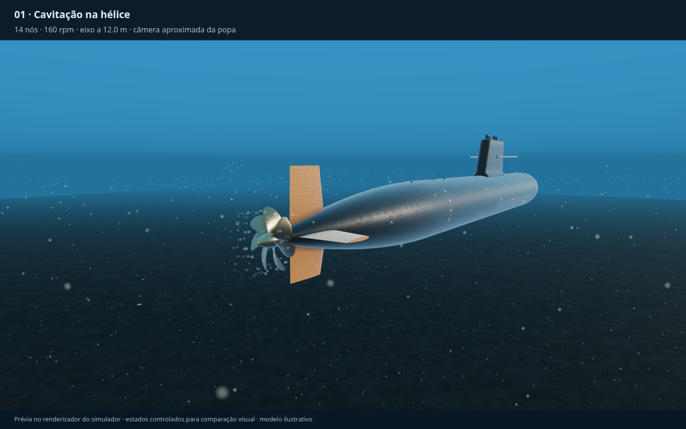
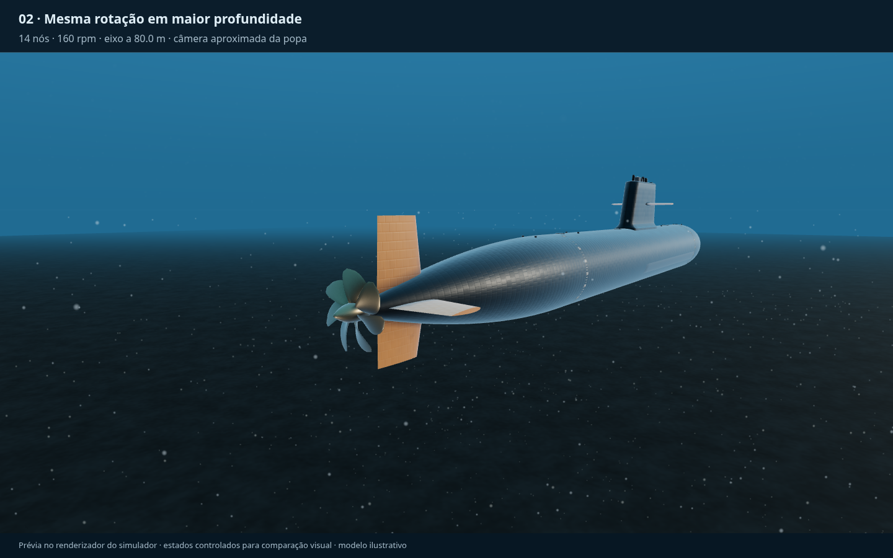
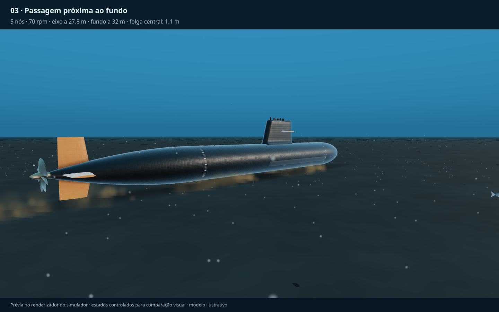
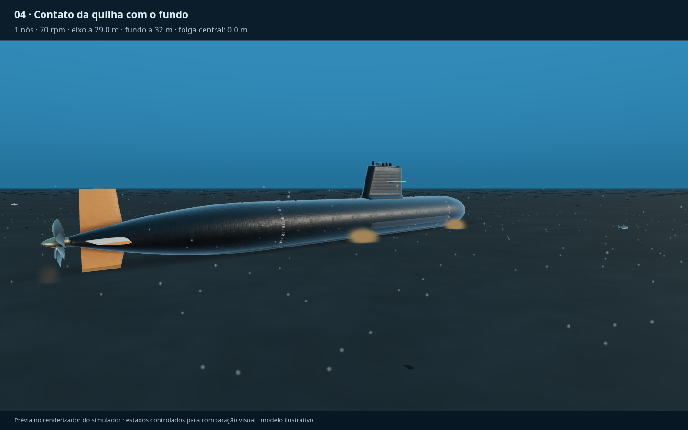
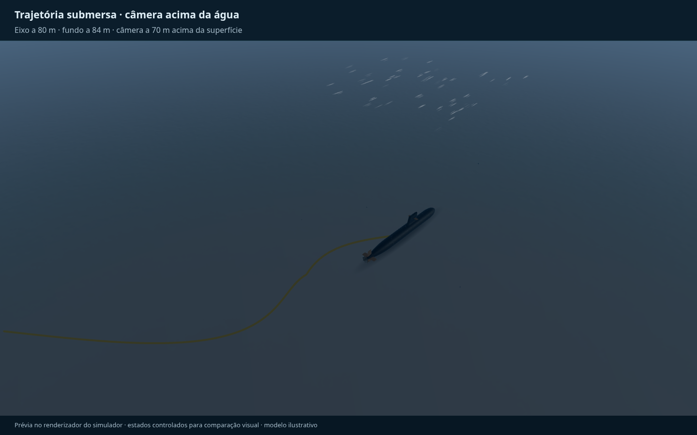
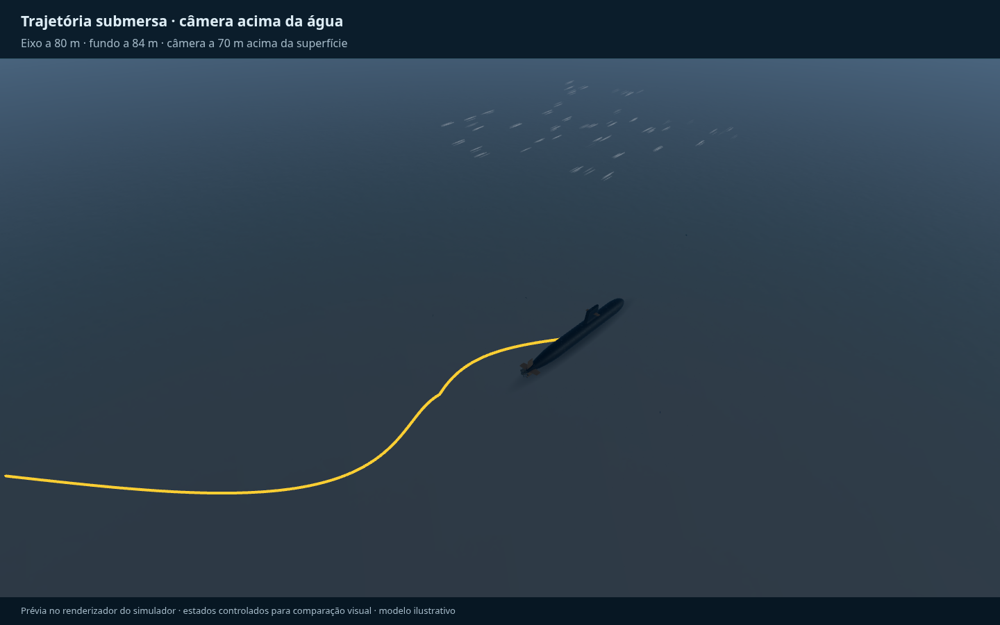

# Cavitação e sedimento — proposta e protótipo visual

Base analisada: `main` em `2c0c325740f52f89a8c8c576b69bea8018cbeb44` (25/10/2026).
Implementação na branch `feat/cavitacao-sedimentos`, aprovada para integração.

## Plano e pontos de integração

1. Ler rotação real (`omega`), velocidade, ângulo do eixo, atitude, temperatura,
   pressão, relevo e geometria do casco existentes.
2. Calcular cavitação visual nas pás e agitação nos três pontos de contato da
   quilha, mais a região da hélice. Isolar essas regras em `underwaterFxModel.ts`.
3. Desenhar partículas em `UnderwaterFx.ts`, dentro de `SubmarineScene.ts`.
   Reutilizar a camada **Esteira**, já sincronizada nas duas janelas. Modo
   **Sem água** também oculta os efeitos. Nenhuma alteração das forças físicas.
4. Conferir ausência de cavitação em baixa rotação/maior pressão, subida e
   sedimentação da areia, pausa, reinício e estado imutável. Capturar quatro
   situações no próprio renderizador: cavitação, maior profundidade, passagem
   rasante e primeiro contato.

Os quatro passos estão implementados como protótipo para avaliação visual.

## Cavitação: por que não usar apenas um limite de profundidade

A queda da pressão na pá pode formar cavidades de vapor. Ao reencontrarem
pressão maior, elas colapsam; não são as bolhas de ar dos suspiros ou dos diesel.
O número de cavitação compara a margem de pressão sobre a pressão de vapor à
pressão dinâmica. A rotação e o escoamento relativo na pá importam mais que uma
velocidade isolada do navio.

Modelo adotado:

```
Vrel² = (ω × 0,9R)² + [U × (1 − fração de esteira)]²
σ = [p(profundidade local da pá) − pv(temperatura)] / (0,5ρVrel²)
intensidade = limitar((0,8 − σ) / 0,45, 0, 1)
```

Pressão e densidade vêm do ambiente simulado. A profundidade da pá usa a
atitude do casco e a elevação local das ondas. A pressão de vapor usa Tetens
(aproximação de água pura). Só são emitidas bolhas na parte submersa do disco;
hélice parada não emite. O modelo aceita rotação avante e a ré.

**0,8 é um coeficiente de calibração visual**, não um dado medido da hélice SX-1.
O simulador não possui distribuição de pressão sobre as pás, curvas de início
por carga/avanço, núcleos de cavitação ou ensaios de túnel. Portanto os valores
abaixo são limiares do protótipo, não limites operacionais reais.

Com hélice de 4,4 m, água a cerca de 22 °C, ρ ≈ 1025 kg/m³, mar calmo e casco
nivelado, a primeira emissão na parte superior do disco fica aproximadamente em:

| Rotação real | Velocidade usada no exemplo | Profundidade máxima do eixo para início |
| --- | --- | --- |
| 80 rpm | 6 nós | 3,6 m |
| 120 rpm | 10 nós | 18 m |
| 160 rpm | 14 nós | 38 m |

São pares ilustrativos independentes, não uma curva de velocidade de equilíbrio
por rpm. Perto do limiar a emissão é fraca/intermitente. A menor profundidade
ou maior rotação, cresce gradualmente. Não há um corte fixo aos 38 m: outras
rotações, velocidades, ondas e atitudes mudam o resultado.

Aspecto: pequenos sprites claros nas pontas das pás, deslocados pelo jato,
com duração visual de 0,18–0,58 s, encolhendo e desaparecendo. Essa duração e o
tamanho aparente são escolhas de legibilidade; não resolvem a dinâmica de uma
bolha individual nem o som, erosão ou perda de rendimento.

## Areia/sedimento junto ao fundo

A água em movimento pode ressuspender partículas; a gravidade e o arrasto
fazem o material se depositar. A resposta depende do tamanho dos grãos,
coesão e tensão de cisalhamento. Como não existe mapa de tipo de solo no
simulador, o protótipo assume fundo sedimentar em toda área submersa.

- Folga medida nos mesmos três pontos da quilha usados pela colisão física,
  transformados pela atitude; uma quarta amostra acompanha a hélice.
- Aproximação visual começa abaixo de **6 m de folga**, enfraquece com o
  quadrado da distância e depende da velocidade e do jato da hélice.
- O primeiro toque (tolerância visual de 15 cm) gera um pulso. Movimento durante
  contato continua levantando material. Parado, sem hélice, a emissão cessa.
- Nuvem castanha, inicialmente ascendente, com dispersão lateral e retorno
  gradual à velocidade de queda de 0,14 m/s. Desaparece ao atingir o relevo ou
  envelhecer (7–16 s). Os sprites representam pequenos volumes de sedimento,
  não grãos individuais. Valores são calibrações gráficas, não CFD.
- As partículas ficam no mundo quando o submarino avança; seguem o tempo de
  simulação, param em pausa e são limpas na troca de motor/reinício do tempo.
- Orçamento de 2600 partículas (1300 na qualidade baixa), um draw call.

## Imagens e reprodução

As imagens são capturas reais do renderizador `SubmarineScene`, com os modelos
3D do projeto. O arquivo `scripts/preview-underwater.html` cria estados
controlados para comparação visual, sem alegar equilíbrio hidrodinâmico.
Não integra o fluxo operacional nem a entrada do build publicado.

1. `npm ci --ignore-scripts` (suficiente para o navegador; não instala o executável Electron).
2. `npm run dev`.
3. Abrir `/scripts/preview-underwater.html?mode=cavitation`, `deep`, `near` ou `contact`.
4. No console do navegador, executar `advancePreview(8)`; para ver o primeiro
   contato, usar `advancePreview(1.2)` logo após abrir a página.






## Verificação

- Suíte completa: 51 arquivos, 389 testes aprovados.
- Build de produção aprovado (aviso de chunk grande já presente no projeto).
- Chromium/Playwright: quatro capturas sem erros JavaScript.
- `scripts/capture-underwater.py` reproduz as capturas com Vite na porta 5173.

## Referências consultadas

- [Cavitation](https://en.wikipedia.org/wiki/Cavitation): formação de vapor em baixa
  pressão e colapso na recuperação de pressão.
- [Cavitation number](https://en.wikipedia.org/wiki/Cavitation_number): definição de
  σ e relação qualitativa entre pressão, velocidade e início de cavitação.
- [Sediment transport](https://en.wikipedia.org/wiki/Sediment_transport): transporte,
  início de movimento por cisalhamento e sedimentação.

Essas referências sustentam os mecanismos e a fórmula geral. Não fornecem os
coeficientes escolhidos para esta hélice fictícia, o alcance de 6 m ou os tempos
visuais do protótipo.

## Trajetória vista através da superfície

A linha já tinha espessura em pixels e `fog: false`, mas o oceano transparente
(ordem 2) era desenhado depois dela e escurecia sua cor. A trajetória agora usa
ordem 3, preservando `depthTest` e as coordenadas do percurso. É uma referência
informativa visível através da água, não uma projeção do caminho na superfície.
A geometria opaca (casco/terreno) continua ocultando os trechos atrás dela.

Captura de controle: eixo a 80 m, fundo a 84 m, câmera 70 m acima da superfície.
Reprodução com Vite e Playwright: `python scripts/capture-trail.py after`.




## Consulta e supervisão

O cálculo de cavitação foi centralizado em `src/sim/systems/cavitation.ts` e é
usado pelo renderizador, pela seção **Configurações → Cavitação da hélice** e
pelo motor de alarmes. A intensidade máxima das pás dispara o alerta de
prioridade média após 1 s acima de ou igual a 5%; normaliza abaixo de 2%.
Os limiares são de supervisão para evitar avisos breves junto ao início, não
alteram o critério de formação das bolhas. Não depende das camadas gráficas.
